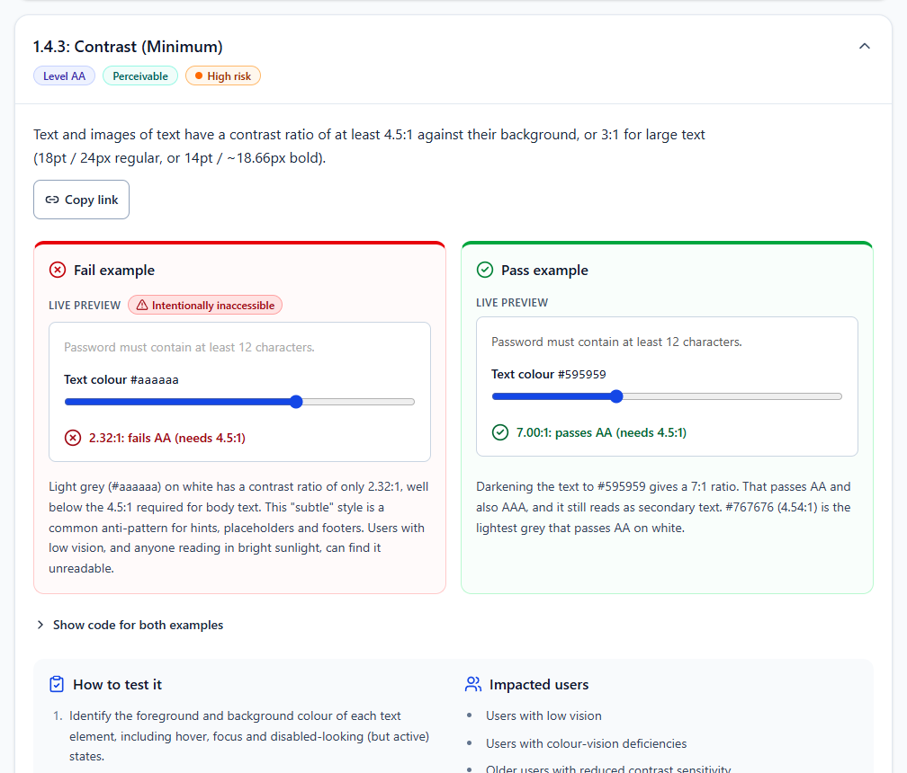
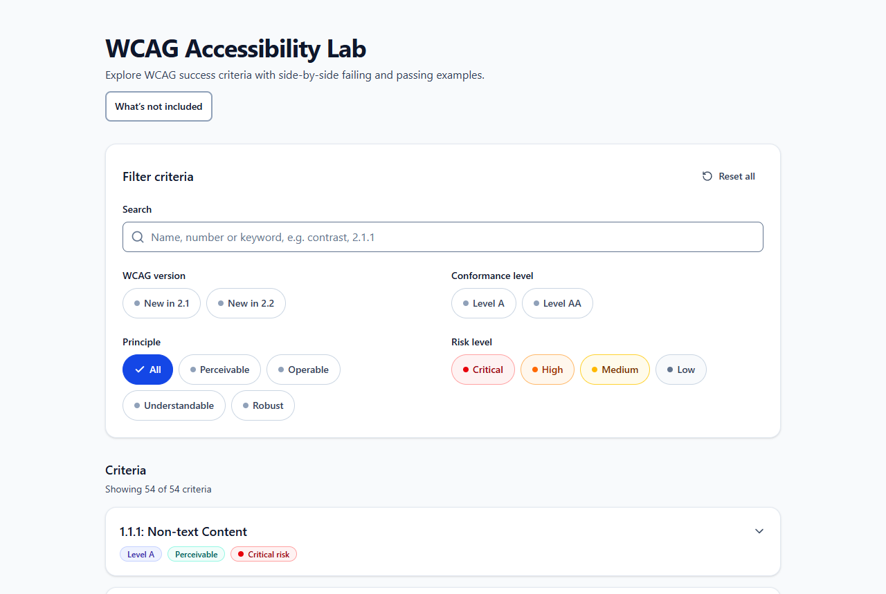

# WCAG Accessibility Lab

**Interactive pass and fail examples for every WCAG 2.2 Level A and AA success criterion.**

**Live site:** https://wcagexamples.nikhil-philip.workers.dev



Most accessibility references describe a rule and show a code snippet. This lab lets you experience each failure: tab into a keyboard trap, try to read a ticker that will not stop, paste into a field that blocks pasting. Then use the fixed version right next to it.

## What's inside

- **54 success criteria.** That is all of WCAG 2.2 Level A and AA except 1.2.4 Captions (Live), which cannot be shown faithfully without a real live stream. 4.1.1 Parsing is also left out, because WCAG 2.2 made it obsolete. Level AAA is out of scope.
- **A live fail example and a live pass example for every criterion**, each with an explanation of why it fails or passes.
- **The code for both**, how to test it (manual and assistive-technology steps), and which users are affected.
- **Filters** by WCAG version (new in 2.1 or 2.2), conformance level, principle and risk level, plus search by name, number or keyword.
- **A page for every criterion**, e.g. `/criteria/1-4-3/`, so you can share or bookmark one. `#1.4.3` works too.
- **Real media** for the captions, transcript and audio-description criteria. The film clip is a public-domain film; the cooking video is under the Pexels License.

The lab itself aims to meet WCAG 2.2 AA. Every fail example is labelled *Intentionally inaccessible* and always sits next to its fix.

<details>
<summary>Home page screenshot</summary>



</details>

## Tech stack

React 19, TypeScript, Vite, Tailwind CSS 4, Radix UI (accordion) and Lucide icons. There is no backend and no cookies. Visits are counted with Cloudflare Web Analytics, which is cookieless.

The site is a static single-page app that is **pre-rendered at build time**. Each criterion page ships as real HTML with its own title, description and canonical link, so search engines and social-media previews can read it without JavaScript. React then hydrates it in the browser.

## Getting started

Requires Node.js 20.19 or later.

```bash
npm install
npm run dev       # development server at http://localhost:5173
npm run build     # type-check, build and pre-render to dist/
npm run preview   # serve the production build locally
npm run lint
```

### Configuration

Before a production build, set the public settings in [`.env`](.env):

| Variable | Used for |
| --- | --- |
| `VITE_SITE_URL` | Canonical links, social previews, `sitemap.xml` and `robots.txt`. The full address with no trailing slash, e.g. `https://wcag-lab.example.com`. |
| `VITE_AUTHOR_NAME` | The "Made by" footer line and the `author` meta tag. |
| `VITE_AUTHOR_GITHUB`, `VITE_AUTHOR_LINKEDIN` | Footer links. Leave either empty to hide it. |

The build warns you if `VITE_SITE_URL` is still the placeholder.

### Deploying

`npm run build` produces a fully static `dist/` folder. Deploy it to any static host, such as Cloudflare Pages, Netlify, Vercel or GitHub Pages, served from the root of a domain.

- **Build command:** `npm run build`
- **Output directory:** `dist`

## How it's built

| Path | What it does |
| --- | --- |
| `src/data/criteria/*.ts` | One data object per criterion: description, fail and pass examples, testing steps and impacted users. Typed by `src/data/wcag-schema.ts`. |
| `src/components/demos/` | One live demo component per kind of example. Each is lazy-loaded when its criterion opens. |
| `src/components/CriterionAccordion.tsx` | The panel for one criterion. |
| `src/site.ts` | Site settings and the `/criteria/<id>/` URL scheme. |
| `src/entry-server.tsx`, `scripts/prerender.mjs` | Build-time pre-rendering of every page, plus `sitemap.xml` and `robots.txt`. |
| `scripts/third-party-licenses.mjs` | Collects the license notices of every bundled package into `third-party-licenses.txt`. |

### Adding or changing a criterion

1. Edit or add a `defineCriterion({...})` entry in the right file under `src/data/criteria/`.
2. Give the fail and pass examples an `interactiveType`. Reuse an existing demo, or add a component in `src/components/demos/` and register it in `InteractiveDemo.tsx`.
3. Run `npm run build`. The new criterion gets its own page and sitemap entry automatically.

## Accessibility testing

- Keyboard-only testing of the whole interface.
- Automated checks with [axe-core](https://github.com/dequelabs/axe-core) on every page (WCAG 2.0, 2.1 and 2.2 A/AA rules plus best practices), excluding the intentionally failing examples: no violations.

The lab has not been independently audited. If you find a barrier, please [open an issue](../../issues).

## Disclaimer

This is an educational resource, not legal advice or an accessibility audit. Matching a pass example does not mean a real site conforms to WCAG. The normative text is the [W3C WCAG 2.2 Recommendation](https://www.w3.org/TR/WCAG22/).

## License

- **Code**, including the code examples shown in the lab: [MIT](LICENSE).
- **Written content** (descriptions, explanations, testing steps, screenshots): [CC BY 4.0](https://creativecommons.org/licenses/by/4.0/). Reuse it freely with credit.
- **Media files** keep their own terms, except the audio drama and the audio description, which are also CC BY 4.0.

See [LICENSE-CONTENT.md](LICENSE-CONTENT.md) for the details.

## Credits

- Film clip: *Night of the Living Dead* (1968), directed by George A. Romero. Public domain.
- Cooking video: ["Making Homemade Vada Pav with Spices"](https://www.pexels.com/video/making-homemade-vada-pav-with-spices-39873486/) by Mugdha Peter, under the [Pexels License](https://www.pexels.com/license/).
- Audio drama *The Delivery Guy* and the audio description of the cooking video: written by Nikhil Philip for this lab, voiced with Clipchamp text-to-speech, with stock sound effects from Clipchamp.
- Icons: [Lucide](https://lucide.dev). Open-source notices are in [`public/third-party-licenses.txt`](public/third-party-licenses.txt).

Made by Nikhil Philip.
